# TeachWell

**Course quality, accessibility and faculty support for a college's Canvas courses, built around how a Center for Teaching and Learning (CTL) works.**

     

TeachWell helps instructors find and fix what gets in students' way in a course. That includes missing alt text, confusing navigation, overloaded weeks, and assignments that don't line up with the course's competencies. It also gives CTL instructional designers one place to review courses against the college's quality standards, follow each fix through to completion, support faculty, and report on course quality across departments and programs.

TeachWell reads a course from Canvas, either by connecting to the Canvas API or from a course export file, and checks it against standards the CTL configures. Instructors get a prioritized improvement guide that explains why each issue matters and how to fix it in Canvas. CTL reviewers add rubric-based reviews, assign revision tasks, answer help requests, and endorse courses that are ready. TeachWell never changes the Canvas course itself.

> **Portfolio project.** All people, courses and institutions in the demo data are fictional, and no institutional affiliation is implied. The demo contains no student data.

**Live demo: [teachwell-demo.onrender.com](https://teachwell-demo.onrender.com/).** Sign in with one click as any fictional persona: instructor, CTL reviewer, academic administrator or system administrator. The free host sleeps when idle, so the first visit can take about a minute to wake up, and the sample data resets daily.

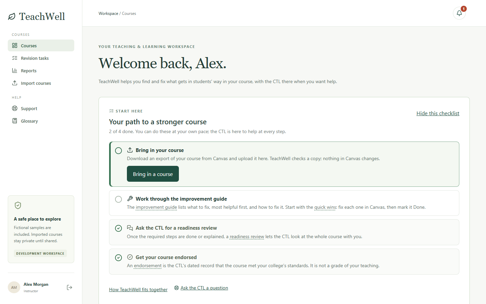

## Built for instructional design work

TeachWell models the day-to-day work of a CTL instructional designer supporting faculty in a competency-based college.

| CTL work | How TeachWell supports it |
| --- | --- |
| **Assess and remediate courses for accessibility and quality** | 42 configurable checks find accessibility barriers: missing, empty or file-name alt text, empty or skipped headings, vague link text, tables without header cells, color-only instructions, and video or audio without captions. They also find design issues such as reading level, page length, module overviews, workload balance, clustered deadlines and deadlines that run out of module order. Accessibility checks carry the WCAG 2.1 success criterion they relate to, and a per-course conformance report summarises them for the college's own documentation ([ADR 018](docs/ADR-018-WCAG-MAPPING-AND-CONFORMANCE.md)). Each issue names the exact page and explains how to fix it in Canvas. Fixes are tracked as revision tasks until they are resolved. |
| **Competency-based curriculum** | Instructors map competencies to assessments. TeachWell flags competencies that nothing assesses and assessments that map to no competency. It also flags vague outcomes and assessments that sit below their outcome's Bloom's level. |
| **Multiple delivery methods** | The CTL maintains versioned standard sets for a department and delivery method (online, hybrid or face-to-face). Each course is checked against the standard set that fits it. |
| **Consistent, evidence-based reviews** | Rubric reviews are pinned to a snapshot of exactly what was reviewed and to the rubric version used. A later edit never rewrites an earlier assessment, and each automated finding is confirmed or rejected by a person. |
| **Faculty technical support** | A support desk with a triage queue for the whole CTL. Instructors can ask for help directly from any improvement step or revision task. |
| **Job aids, trainings and workshops** | A knowledge base for job aids, and workshop scheduling with capacity and waitlists. Both are linked from the improvement steps and the glossary, where faculty need them. |
| **Plain language for faculty** | A glossary explains terms such as WCAG, UDL, Bloom's taxonomy and cognitive load wherever they appear, with links to free reading and the CTL's own resources. |
| **Course and program quality, ready for accreditation reporting** | Readiness reviews end in dated, permanent CTL endorsements, with re-checks when a course changes substantially. A read-only oversight view shows readiness, common issues and progress by department and program, with CSV export. Figures describe courses, never rank people, and every figure states its scope and date. |
| **Student privacy (FERPA)** | TeachWell reads course content only. It never needs student records, grades or submissions. |

The automated checks support a reviewer's judgment; they are not a compliance or accessibility certification.

## Screenshots

| | |
| --- | --- |
| 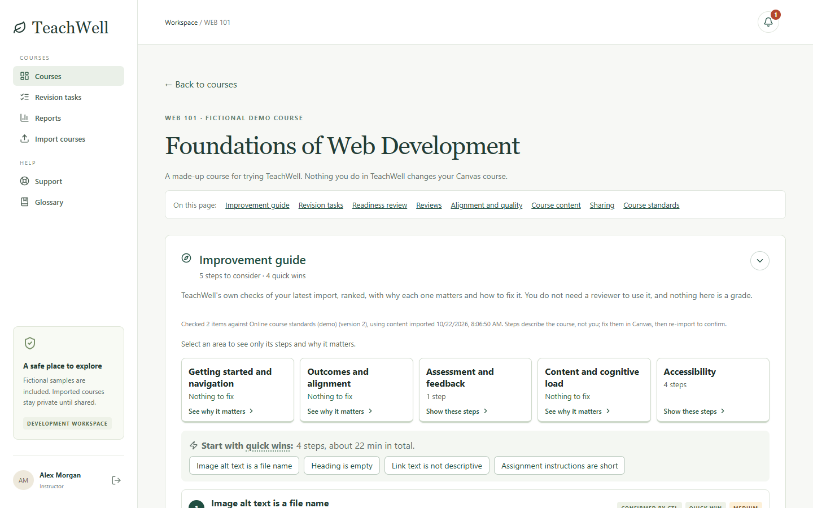 **Improvement guide.** TeachWell's own checks, ranked by impact, grouped by area, with quick wins first. | 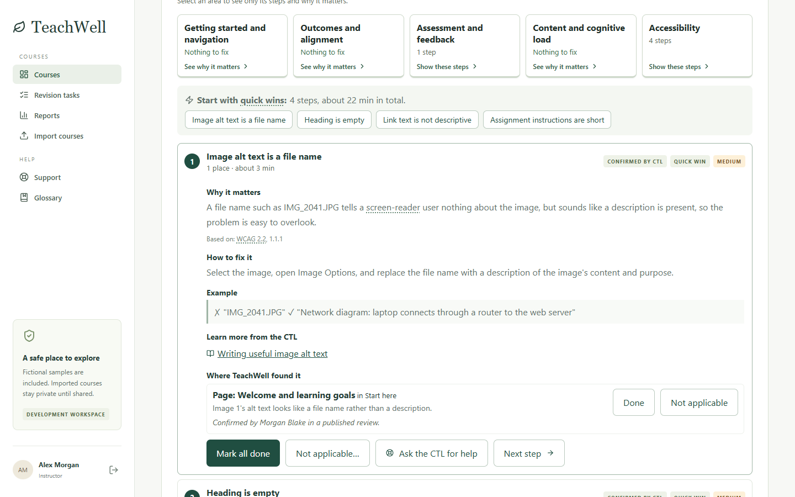 **A guide step.** Why it matters, how to fix it in Canvas, an example, the CTL's linked resources, and every place it was found. |
| 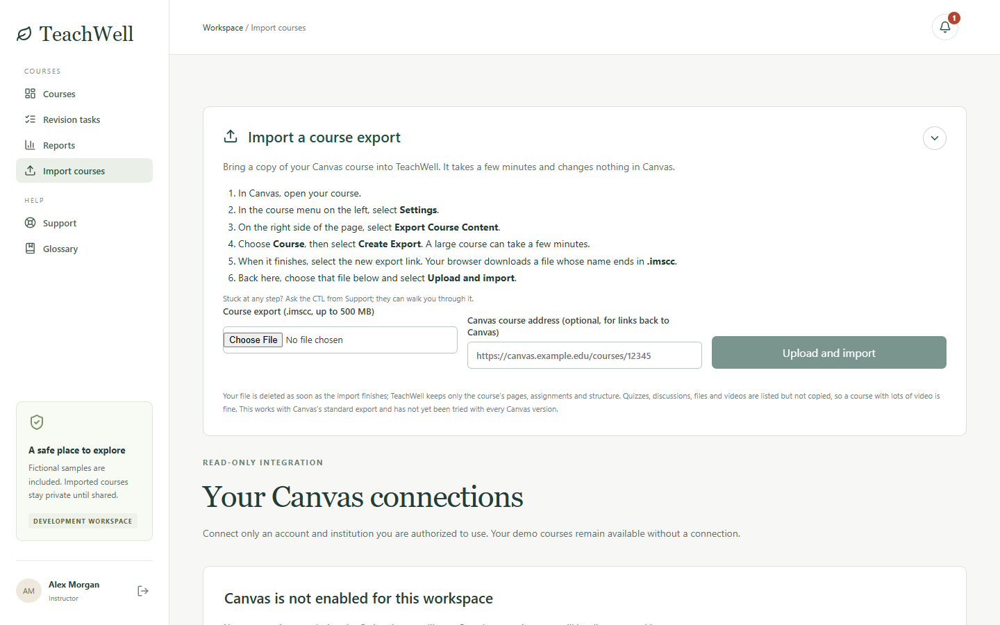 **Bring in a course.** Upload a Canvas course export, or connect to the Canvas API. Either way the Canvas course is never changed. | 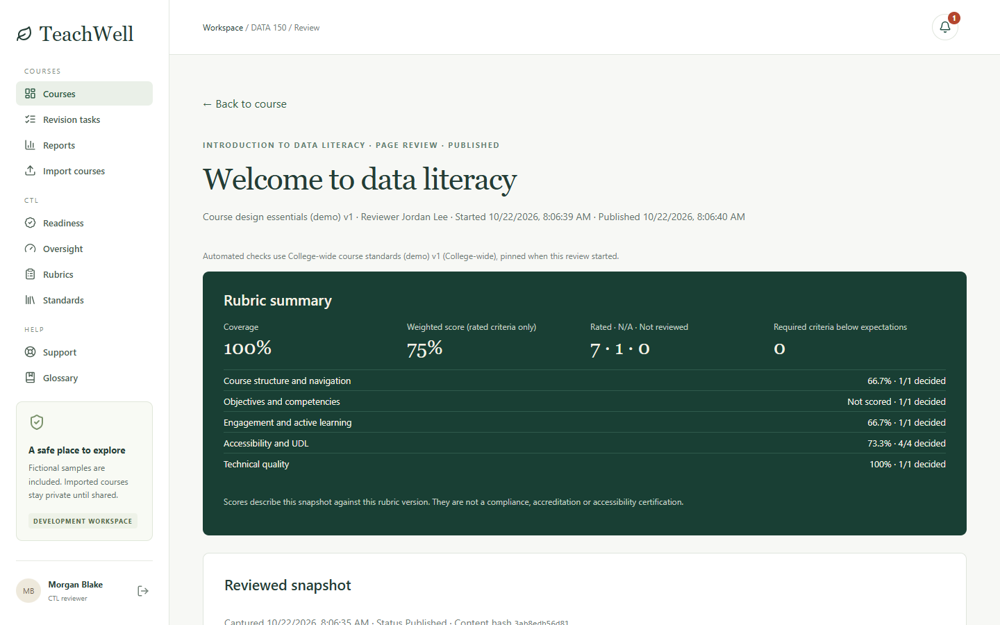 **Rubric-based review.** Coverage, weighted score, N/A and not-reviewed counts, pinned to a rubric version. |
| 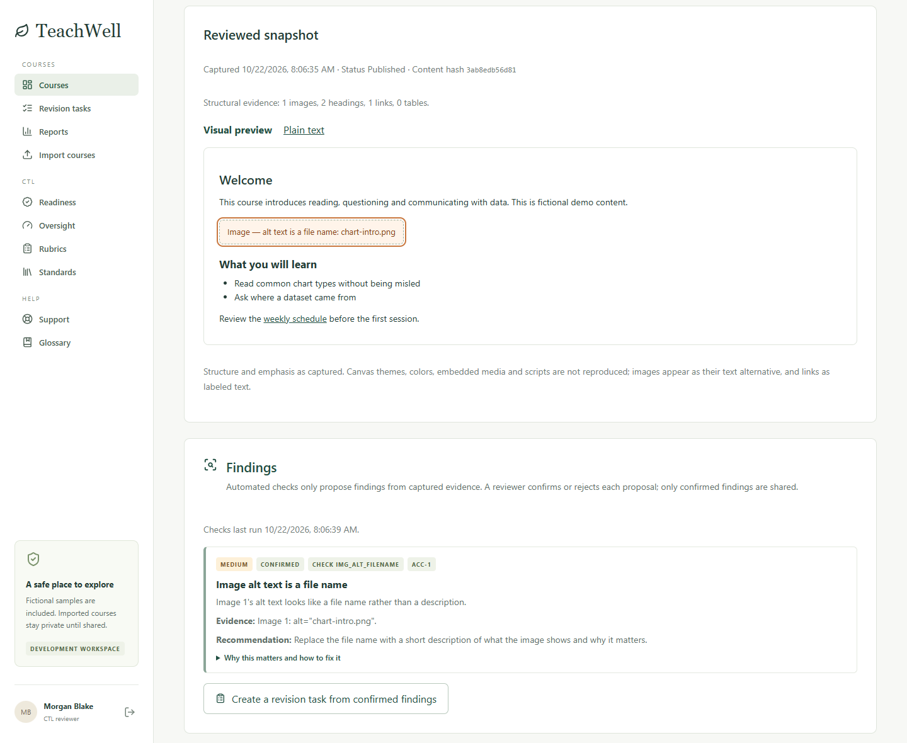 **Reviewed snapshot.** A safe preview of exactly what was reviewed, with issues flagged in place. The reviewer confirms each automated finding. | 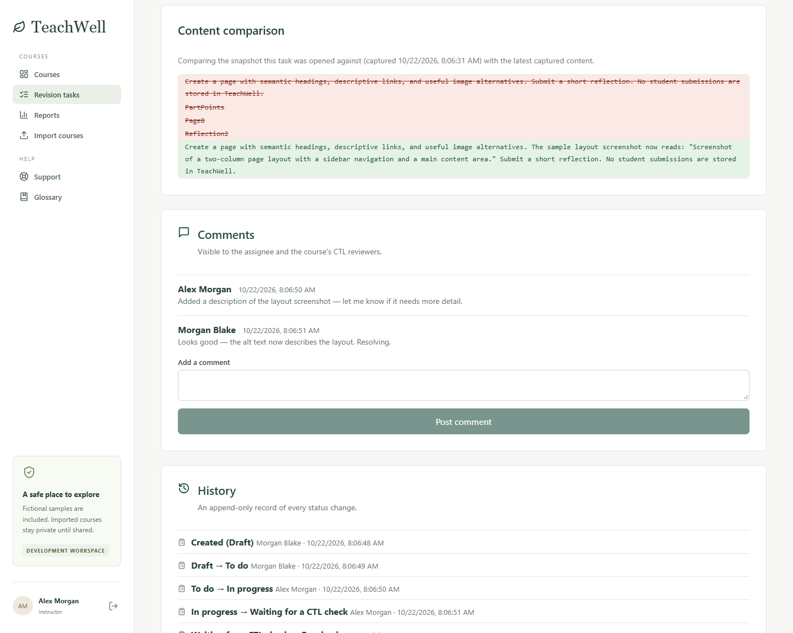 **Revision task.** Before/after comparison, a shared comment thread and a permanent status history. |
| 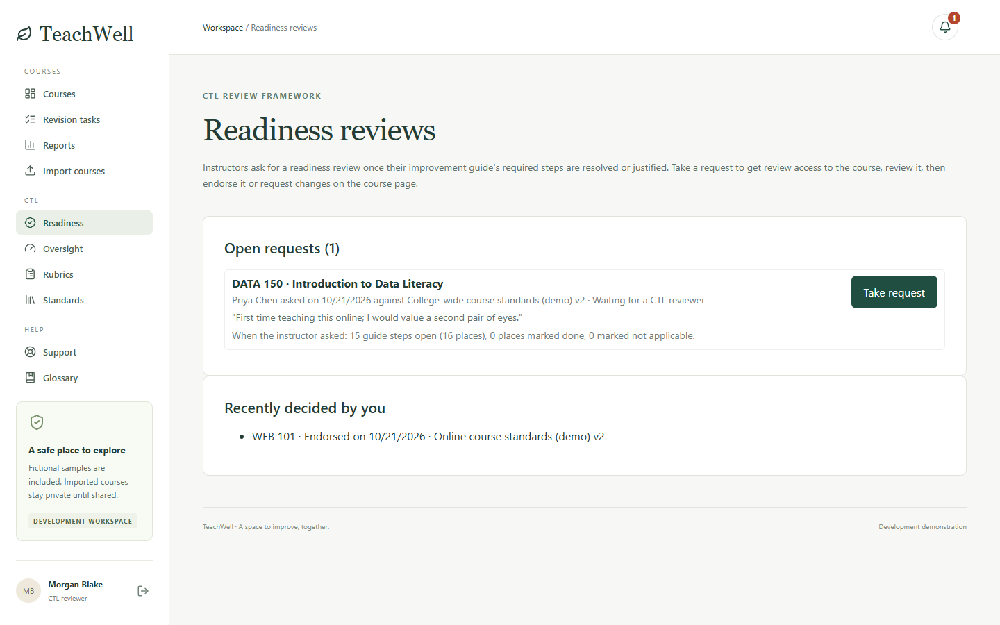 **Readiness queue.** Instructors ask for a review once the guide's required steps are done. The CTL takes it, then endorses the course or requests changes. | 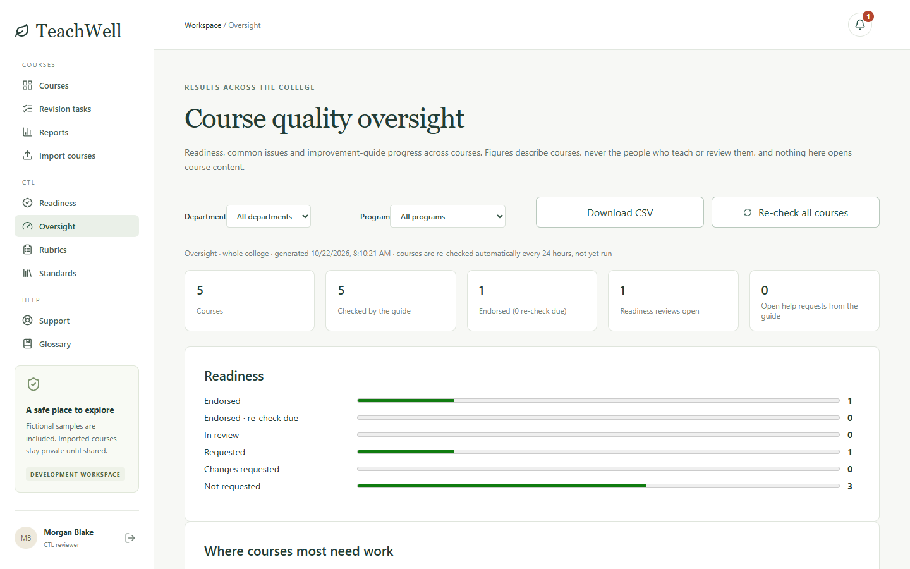 **Oversight.** College-wide readiness, filterable by department and program, with scope and date on every figure. |
| 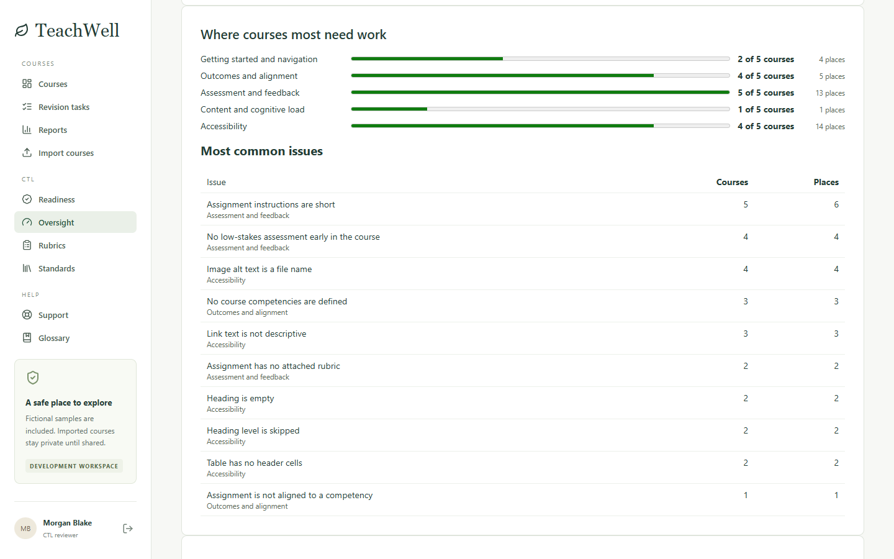 **Where courses need work.** Issues aggregated by area and check. Figures describe courses, never people. | 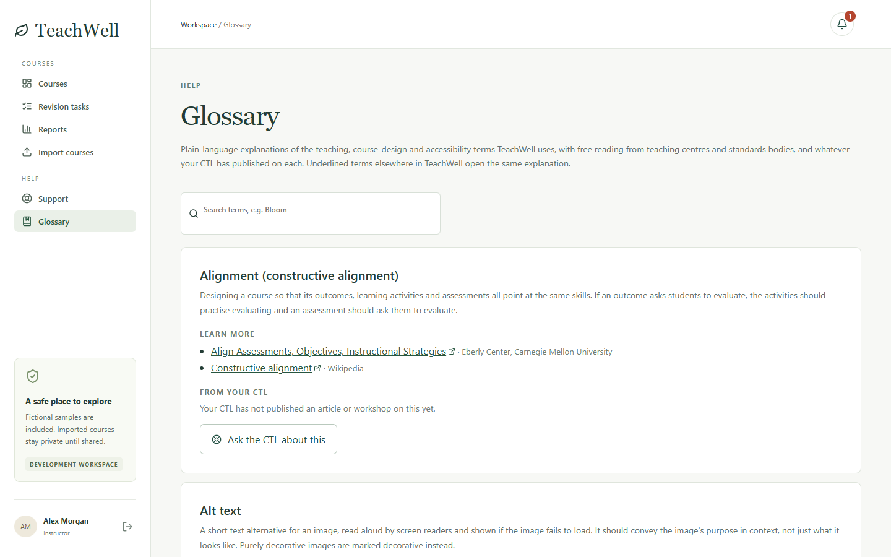 **Glossary.** Plain-language explanations of jargon such as Bloom's taxonomy, WCAG and UDL, with links and the CTL's own resources. |
| 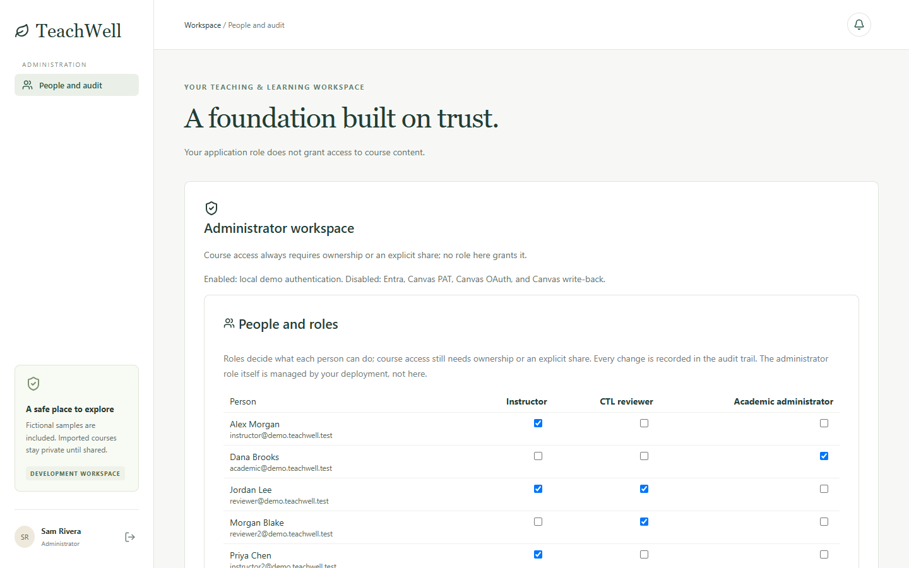 **People and roles.** Audited role grants. No role grants course access by itself. | 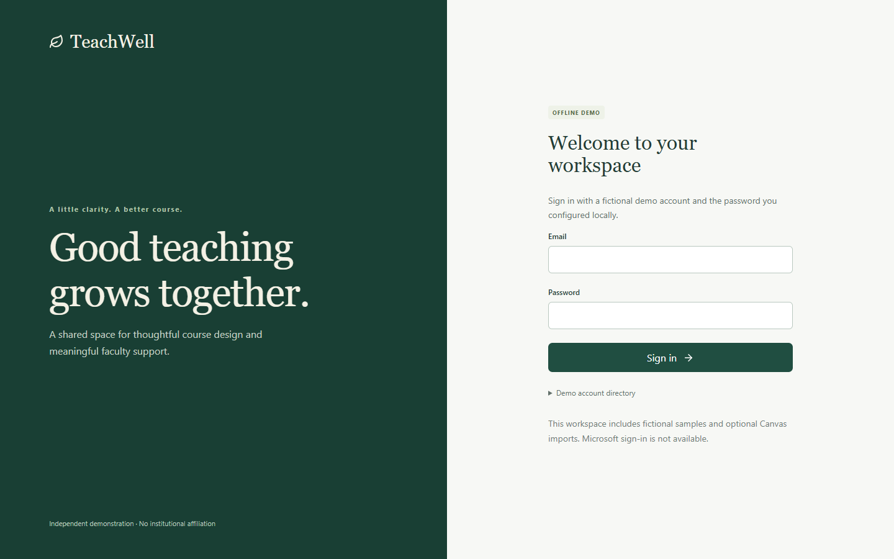 **Sign-in.** ASP.NET Core Identity, with one-click accounts for the fictional demo personas. |

## Who uses it

- **Instructors:** a *Start here* checklist, the improvement guide, competency mapping, revision tasks, and help from the CTL.
- **CTL reviewers:** versioned rubrics and standard sets, page-level and whole-course reviews, a readiness queue with endorsements, support ticket triage, a knowledge base and workshops.
- **Academic administrators:** a read-only, college-wide view of course quality and readiness. It never opens course content.
- **System administrators:** audited role management and a filterable audit trail.

See the **[demo guide](docs/DEMO_GUIDE.md)** for the full feature reference and step-by-step walkthroughs.

## Engineering highlights

- **Clean layering.** Domain, Application, Infrastructure and API projects, plus a React SPA with a typed API client. Integrations sit behind `IIdentityProvider`, `ICanvasClient` and `ICourseContentSource`, with clearly labelled demo adapters.
- **Server-side authorization on every resource.** Tenant isolation and per-course ACLs: owners plus explicit shares. Neither the reviewer nor the admin role grants global access, and unshared resources return 404 to prevent IDOR.
- **Immutable history.** Published rubric versions, content snapshots, reviews and endorsements are immutable, enforced both in EF Core and in PostgreSQL. Later edits create new versions instead of rewriting past assessments.
- **Secure session design.** A same-origin BFF with HttpOnly, Secure, SameSite=Strict cookies; CSRF tokens on every state-changing request; account lockout and login rate limiting; problem-details errors.
- **Untrusted input handled defensively.**
  - Canvas HTML is parsed with scripting disabled and re-serialized through an allowlist. No scripts, styles, URLs or images are rendered.
  - Export uploads are protected against zip bombs, path traversal and XXE.
  - Outbound Canvas requests go only to approved hosts and public IPs, to prevent SSRF.
- **Secrets kept out of reach.** Canvas personal access tokens are encrypted with AES-256-GCM, never returned after saving, and redacted from logs and audit records. There are no default passwords.
- **Audit trail** for permission changes, sharing, reviews, revisions, readiness decisions and integration changes.
- **Tests.**
  - More than 200 xUnit unit and integration tests, run against SQLite and against real PostgreSQL.
  - 20 Playwright specs in Microsoft Edge, each run against an isolated, throwaway database.
  - Coverage includes permission denials, invalid input, CSRF and malicious HTML.
- **A hosted demo that never makes visitors wait.** The sample data is rebuilt daily in a separate PostgreSQL schema, then swapped in with one transaction. Visitors never wait for a reset, even though the free instance sleeps when idle ([ADR 017](docs/ADR-017-HOSTED-PUBLIC-DEMO.md)).
- **Documented decisions.** 20 ADRs under [docs/](docs/) record every non-obvious choice, with its trade-offs and limitations.

## Run locally (Windows)

Requires .NET SDK 9 and Node.js 22 with npm. For PostgreSQL 17, use installed binaries or extract the portable distribution into `.local/pgsql`.

```powershell
# One-time local HTTPS trust; Windows may ask for confirmation.
dotnet dev-certs https --trust

# Build, start PostgreSQL, apply migrations, seed, and serve the app.
powershell -NoProfile -ExecutionPolicy Bypass -File scripts/Start-Local.ps1
```

Open **https://localhost:7143** and pick a demo account. On this computer, the sign-in screen offers one-click buttons ([ADR 012](docs/ADR-012-DEMO-QUICK-SIGN-IN.md)); run with `-NoQuickLogin` to turn them off. On first start you choose a demo password at the terminal prompt. Local database and demo credentials are stored encrypted for the current Windows user under `.local`. PostgreSQL listens only on 127.0.0.1:55432, and no system service or container is installed. Ctrl+C stops the app. To stop PostgreSQL:

```powershell
powershell -NoProfile -ExecutionPolicy Bypass -File scripts/Stop-LocalDatabase.ps1
```

See [local development](docs/LOCAL_DEVELOPMENT.md) for binary paths, database lifecycle, tests and troubleshooting.

### Demo accounts

| Account | Roles | Initial course access |
| --- | --- | --- |
| instructor@demo.teachwell.test (Alex Morgan) | Instructor | Owns WEB 101 and DES 120 |
| reviewer@demo.teachwell.test (Jordan Lee) | CTLReviewer, Instructor | WEB 101 and DATA 150 shared for review; owns EDU 210 |
| academic@demo.teachwell.test (Dana Brooks) | AcademicAdmin | Read-only oversight across the college; no course content |
| admin@demo.teachwell.test (Sam Rivera) | SystemAdmin | No automatic course access; manages roles |
| instructor2@demo.teachwell.test (Priya Chen) | Instructor | Owns DATA 150 and ASMT 210 (deliberately unshared) |
| reviewer2@demo.teachwell.test (Morgan Blake) | CTLReviewer | WEB 101, DES 120, DATA 150 and EDU 210 shared |

People with more than one role switch between roles with **Viewing as**, under their name in the sidebar. The seed is idempotent and fills every feature with worked examples:
- published and draft reviews
- revision tasks and support tickets in every status
- competencies with a deliberate gap
- knowledge articles and workshops, one of them full to show waitlisting
- readiness requests and an endorsement

## Architecture

```
src/
  TeachWell.Domain          Entities and value objects
  TeachWell.Application     Contracts, policies, review/check engine abstractions
  TeachWell.Infrastructure  EF Core + Identity, migrations, seed, Canvas API + export adapters, demo adapters
  TeachWell.Api             ASP.NET Core endpoints, authorization, sessions, CSRF, hosts the built SPA
  TeachWell.Web             React 19 + TypeScript SPA (Vite), typed API client, Playwright specs
tests/
  TeachWell.IntegrationTests  xUnit unit and integration tests (SQLite or PostgreSQL)
```

Design documents: [roadmap](docs/ROADMAP.md), [architecture](docs/ARCHITECTURE.md), [data model](docs/DATA_MODEL.md), [API contract](docs/API_CONTRACT.md), [review framework](docs/REVIEW_FRAMEWORK.md), [workflows](docs/WORKFLOWS.md), [Canvas connections](docs/CANVAS_CONNECTIONS.md), [local development](docs/LOCAL_DEVELOPMENT.md).

Decision records: [foundation](docs/ADR-001-PHASE-1.md), [local development and sharing](docs/ADR-002-LOCAL-DEVELOPMENT-AND-SHARING.md), [Canvas connections](docs/ADR-003-CANVAS-CONNECTIONS.md), [course import](docs/ADR-004-CANVAS-COURSE-IMPORT.md), [review framework](docs/ADR-005-REVIEW-FRAMEWORK.md), [revision tasks](docs/ADR-006-REVISION-TASKS.md), [faculty support](docs/ADR-007-FACULTY-SUPPORT.md), [alignment and reporting](docs/ADR-008-ALIGNMENT-AND-REPORTING.md), [course review and preview](docs/ADR-009-COURSE-REVIEW-AND-PREVIEW.md), [course export import](docs/ADR-010-COURSE-EXPORT-IMPORT.md), [review engine and improvement guide](docs/ADR-011-REVIEW-ENGINE-AND-IMPROVEMENT-GUIDE.md), [one-click demo sign-in](docs/ADR-012-DEMO-QUICK-SIGN-IN.md), [readiness review and endorsement](docs/ADR-013-READINESS-REVIEW-AND-ENDORSEMENT.md), [oversight and Academic administrator](docs/ADR-014-OVERSIGHT-AND-ACADEMIC-ADMINISTRATOR.md), [glossary](docs/ADR-015-GLOSSARY.md), [plain language and start path](docs/ADR-016-PLAIN-LANGUAGE-AND-START-PATH.md), [hosted public demo](docs/ADR-017-HOSTED-PUBLIC-DEMO.md), [WCAG mapping and conformance](docs/ADR-018-WCAG-MAPPING-AND-CONFORMANCE.md), [syllabus import and required elements](docs/ADR-019-SYLLABUS-IMPORT-AND-REQUIRED-ELEMENTS.md), [Ally report ingestion](docs/ADR-020-ALLY-REPORT-INGESTION.md).

## Project status

Working today, verified with fictional data:
- Canvas course export import, also verified with a real export from a college's Canvas
- the Canvas API connection
- the improvement guide and configurable standards
- rubric-based reviews and revision tasks
- the faculty support desk
- competency alignment and reporting
- readiness endorsement and oversight

**Roadmap.** [docs/ROADMAP.md](docs/ROADMAP.md) records how TeachWell compares to Anthology Ally, what it should build as a result, and what it deliberately will not build. In short: ingest Ally's file-level findings rather than reimplement them, and spend the saved effort on the course-design and evidence work Ally has no concept of. Also planned:
- **Live Canvas API test:** the API connection is built and tested against simulated Canvas responses. It still needs testing with a live Canvas account.
- **Campus integration:** Microsoft sign-in, a Canvas developer key or LTI 1.3 launch with scheduled re-sync, and optional instructor-approved changes written back to Canvas. These need the institution's security review and approval.
- **AI suggestions:** for example, drafting alt text or rewriting a vague outcome. They would be off by default, opt-in, never applied automatically, and need institutional approval.
- **Accessibility of TeachWell itself:** a manual screen-reader, keyboard, narrow-screen and contrast review.

## Deployment limits

Password demo sign-in exists only in local development. The public demo uses one-click sign-in and only ever holds fictional seed data ([ADR 017](docs/ADR-017-HOSTED-PUBLIC-DEMO.md)). The Canvas API connection is opt-in; Microsoft sign-in, Canvas OAuth and write-back are not implemented. A real deployment would need:
- least-privilege database accounts
- externally managed encryption keys
- supported LTS runtime updates
- operational hardening
- an institutional privacy and security review
